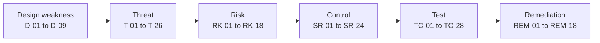
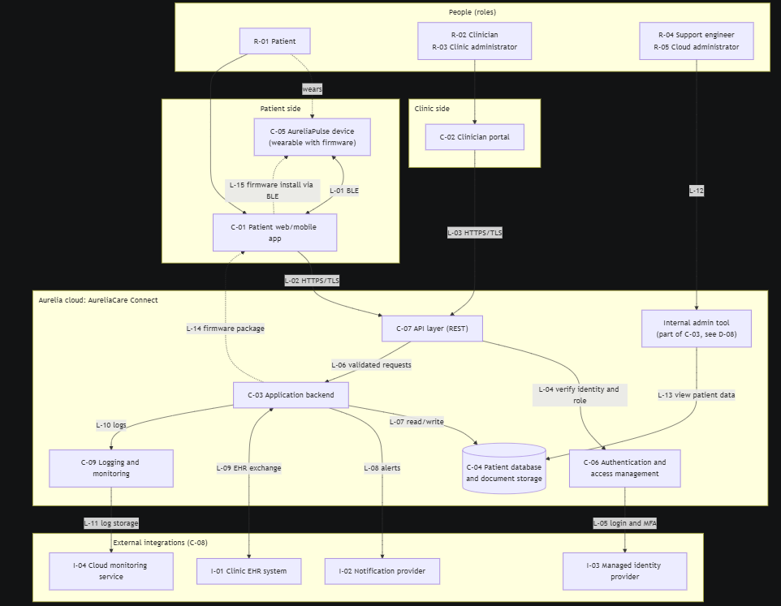
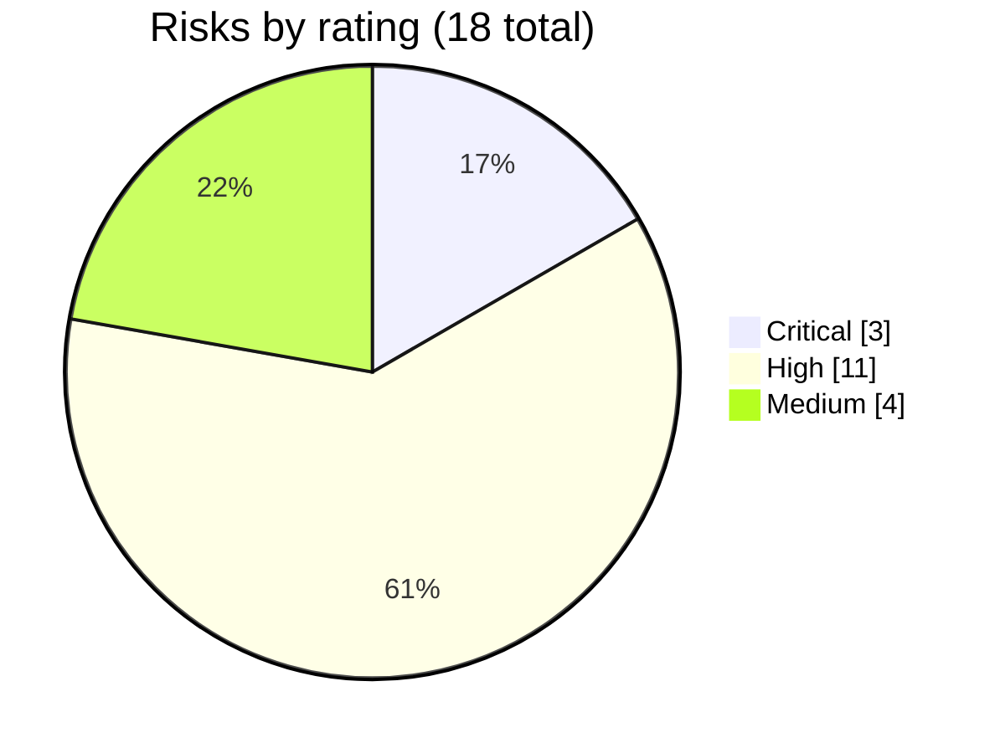

<div align="center">

# Cybersecurity Risk & Product Security Assessment
### of a Connected Healthcare Platform

*A structured, desk-based security assessment of a fictional remote patient-monitoring platform*


</div>

> [!IMPORTANT]
> **Everything here is fictional.** *Aurelia Health Technologies*, *AureliaCare Connect* and *AureliaPulse* are invented.
> No real company, medical device, patient or production system was assessed, and all data is synthetic.
> This project does **not** claim penetration-testing experience, SIEM experience, medical-device certification or regulatory compliance.

**Author:** Kushagra Singh · Final-year B.Tech (Computer Science & Business Systems)
**Career focus:** information security, security governance, risk, controls and product security

---

## Contents

[Overview](#overview) · [Quick tour](#quick-tour-5-minutes) · [The system](#the-fictional-system) · [Method](#methodology) · [Results](#key-results-fictional) · [Deliverables](#deliverables) · [Honesty and status](#honesty-and-activity-status) · [Repository map](#repository-map) · [Limitations](#limitations) · [Licence](#licence)

---

## Overview

AureliaCare Connect lets clinics monitor patients between visits using a wrist-worn device, a patient app, a clinician portal, a cloud backend and a database of sensitive patient information. Because it handles health data *and* connects to a physical device, security failures could affect both privacy and patient safety.

This project assesses the **design** of that platform the way a product-security or risk analyst would:

-  **Describe** it: 9 components, 5 roles, 4 integrations, 14 data flows, 7 trust boundaries
-  **Model threats** with STRIDE: 26 threats traced to design weaknesses
-  **Rate and own risks**: 18 risks scored by likelihood × impact
-  **Define controls**: 24 security requirements mapped to NIST CSF 2.0 and ISO/IEC 27001:2022 themes
-  **Plan testing**: 28 test cases with expected results and blank evidence fields
-  **Rehearse an incident** and review a synthetic authentication log
-  **Report to executives** with a prioritised roadmap

Every item is traceable end to end:



## Quick tour (5 minutes)

| If you have... | Read |
|----------------|------|
| **1 minute** | This page, then the [executive report](reports/01-executive-security-assessment-report.md) summary |
| **5 minutes** | [Data-flow diagram](diagrams/02-data-flow-diagram.md) → [risk register](risk-register/01-risk-register.md) → [control matrix](control-matrix/01-security-requirements-and-controls.md) |
| **15 minutes** | Add the [STRIDE threat model](docs/04-stride-threat-model.md), [test plan](test-plan/01-product-security-test-plan.md) and [incident scenario](docs/06-incident-response-scenario.md) |
| **Everything** | Follow the numbered files in [`docs/`](docs/) from `01` onward |

## The fictional system

<p align="center">
  
</p>

*Architecture of the fictional platform (source: [`diagrams/01-architecture-diagram.md`](diagrams/01-architecture-diagram.md)). The [data-flow diagram](diagrams/02-data-flow-diagram.md) adds six trust zones and seven trust boundaries.*

| Area | What it contains |
|------|------------------|
| Patient side | AureliaPulse wearable (Bluetooth LE, over-the-air firmware), patient web/mobile app |
| Clinic side | Clinician portal used by clinicians and clinic administrators |
| Aurelia cloud | API layer, authentication, backend, internal admin tool, patient database, logging |
| Third parties | Clinic EHR system, notification provider, identity provider, cloud monitoring |

## Methodology

| # | Stage | Output |
|:-:|-------|--------|
| 1 | Scope and assumptions | [Project scope](docs/01-project-scope.md) |
| 2 | Describe the system and invent deliberate weaknesses (D-01 to D-09) | [System overview](docs/02-organisation-and-system-overview.md) |
| 3 | Draw architecture, then data flows and trust boundaries | [Diagrams](diagrams/) |
| 4 | Inventory and classify assets | [Asset inventory](docs/03-asset-and-data-inventory.md) |
| 5 | Model threats with STRIDE | [Threat model](docs/04-stride-threat-model.md) |
| 6 | Rate risks (likelihood × impact) and assign owners | [Risk register](risk-register/01-risk-register.md) |
| 7 | Define and trace security requirements | [Control matrix](control-matrix/01-security-requirements-and-controls.md) |
| 8 | Map to frameworks at theme level | [Framework mapping](control-matrix/02-framework-mapping.md) |
| 9 | Plan product security tests | [Test plan](test-plan/01-product-security-test-plan.md) |
| 10 | Write hypothetical findings with remediation | [Findings](docs/05-hypothetical-vulnerability-findings.md) |
| 11 | Rehearse an incident; review synthetic logs | [Scenario](docs/06-incident-response-scenario.md) · [Log exercise](sample-data/) |
| 12 | Track remediation and report | [Tracker](risk-register/02-remediation-tracker.md) · [Report](reports/01-executive-security-assessment-report.md) |

## Key results (fictional)

These are qualitative ratings on an invented design, not measurements of any real system.



### Risk heat map

| Impact ↓ / Likelihood → | 1 Rare | 2 Unlikely | 3 Possible | 4 Likely | 5 Almost certain |
|:--|:--:|:--:|:--:|:--:|:--:|
| **5 Severe** | 🟨 | 🟧 RK-04, RK-12 | 🟧 RK-03, RK-05, RK-11 | 🟥 RK-01 | 🟥 |
| **4 Major** | 🟩 | 🟨 RK-18 | 🟧 RK-06, RK-08, RK-10, RK-14, RK-15, RK-16 | 🟥 RK-02, RK-07 | 🟥 |
| **3 Moderate** | 🟩 | 🟨 RK-09 | 🟨 RK-13, RK-17 | 🟧 | 🟧 |
| **2 Minor** | 🟩 | 🟩 | 🟨 | 🟨 | 🟧 |
| **1 Negligible** | 🟩 | 🟩 | 🟩 | 🟩 | 🟨 |

🟥 Critical (16 to 25) · 🟧 High (10 to 15) · 🟨 Medium (5 to 9) · 🟩 Low (1 to 4)

### Highest-rated risks

| Risk | Score | Rating | Owner |
|------|:----:|:------:|:-----:|
| **RK-01** Broken access control exposes other patients' data | 20 | 🟥 Critical | O-02 |
| **RK-02** Patient account takeover | 16 | 🟥 Critical | O-02 |
| **RK-07** Security logs are not reviewed, so malicious activity goes undetected | 16 | 🟥 Critical | O-03 |
| **RK-03** Excessive support and administrator access to patient data | 15 | 🟧 High | O-03 |
| **RK-05** Compromise of the shared EHR integration API key | 15 | 🟧 High | O-04 |
| **RK-11** Cloud misconfiguration or cloud administrator compromise | 15 | 🟧 High | O-04 |

### Themes

1. **Access control:** inconsistent, undocumented rules and broad support access put patient data at the greatest risk.
2. **Account protection:** optional patient MFA, no login throttling and prompt-fatigue exposure for clinicians.
3. **Detection and response:** logs exist but are not reviewed, and there is no rehearsed incident plan.
4. **Device trust:** firmware is not fully verified and device credentials have basic protection, which matters for safety as well as privacy.

Full detail: [executive report](reports/01-executive-security-assessment-report.md).

## Deliverables

| # | Deliverable | Location |
|:-:|-------------|----------|
| 1 | README and scope | `README.md` · [`docs/01-project-scope.md`](docs/01-project-scope.md) |
| 2 | Organisation and system overview | [`docs/02-organisation-and-system-overview.md`](docs/02-organisation-and-system-overview.md) |
| 3 | Architecture diagram | [`diagrams/01-architecture-diagram.md`](diagrams/01-architecture-diagram.md) |
| 4 | Data-flow diagram and trust boundaries | [`diagrams/02-data-flow-diagram.md`](diagrams/02-data-flow-diagram.md) |
| 5 | Asset and sensitive-information inventory | [`docs/03-asset-and-data-inventory.md`](docs/03-asset-and-data-inventory.md) |
| 6 | STRIDE threat model | [`docs/04-stride-threat-model.md`](docs/04-stride-threat-model.md) |
| 7 | Risk register | [`risk-register/01-risk-register.md`](risk-register/01-risk-register.md) · [`.csv`](risk-register/01-risk-register.csv) |
| 8 | Security requirements and control matrix | [`control-matrix/01-security-requirements-and-controls.md`](control-matrix/01-security-requirements-and-controls.md) · [`.csv`](control-matrix/01-security-requirements-and-controls.csv) |
| 9 | NIST CSF 2.0 and ISO/IEC 27001 mapping | [`control-matrix/02-framework-mapping.md`](control-matrix/02-framework-mapping.md) |
| 10 | Product security test plan | [`test-plan/01-product-security-test-plan.md`](test-plan/01-product-security-test-plan.md) |
| 11 | Hypothetical findings and remediation | [`docs/05-hypothetical-vulnerability-findings.md`](docs/05-hypothetical-vulnerability-findings.md) |
| 12 | Incident-response scenario | [`docs/06-incident-response-scenario.md`](docs/06-incident-response-scenario.md) |
| 13 | Remediation tracking register | [`risk-register/02-remediation-tracker.md`](risk-register/02-remediation-tracker.md) · [`.csv`](risk-register/02-remediation-tracker.csv) |
| 14 | Executive security assessment report | [`reports/01-executive-security-assessment-report.md`](reports/01-executive-security-assessment-report.md) |
| + | Synthetic log dataset and review exercise | [`sample-data/`](sample-data/) |
| + | Framework and source references | [`references/README.md`](references/README.md) |

## Honesty and activity status

Every activity carries exactly one label so a simulation can never be mistaken for real testing.

| Label | Meaning | Applies to |
|-------|---------|-----------|
| **Simulated** | Invented scenario or data | The company, platform, device, risks, findings, incident |
| **Documented** | Written analysis or plan, nothing technical performed | Threat model, controls, framework mapping, test plan |
| **Executed** | The author actually did it | The synthetic log review only ([worksheet](sample-data/03-review-worksheet.md)) |
| **Verified** | Executed result independently checked, with evidence | **Nothing** |

| Claim | Status |
|-------|--------|
| Penetration test or vulnerability scan performed | ❌ No |
| Test cases executed | ❌ No, all 28 are *Not executed* |
| Findings discovered in a real system | ❌ No, all 6 are hypothetical |
| SIEM experience | ❌ No, the log exercise is a small manual review of synthetic data |
| Regulatory compliance or certification | ❌ None claimed. Framework mapping is theme-level only |
| Controls implemented | ❌ No, all 24 are *Proposed* |

## Repository map

```text
.
├── README.md
├── LICENSE
├── docs/                 scope, system overview, assets, threat model, findings, incident scenario
│   └── images/           architecture diagram
├── diagrams/             architecture and data-flow diagrams (Mermaid)
├── risk-register/        risk register and remediation tracker (.md and .csv)
├── control-matrix/       security requirements and NIST CSF 2.0 / ISO 27001 mapping
├── test-plan/            28 designed test cases with evidence fields
├── sample-data/          synthetic authentication log, review script and worksheet
├── reports/              executive security assessment report
└── references/           primary framework sources
```

## Limitations

1. **Desk-based.** No live system exists, so nothing was tested or verified.
2. **Subjective ratings.** Likelihood and impact are qualitative judgements that have not been peer reviewed.
3. **Author-chosen weaknesses.** Findings illustrate method and reporting, not discovery.
4. **Theme-level mapping.** This is not an audit or a statement of conformity.
5. **No legal analysis.** Healthcare and privacy regulation varies by country and is not assessed.
6. **Student author.** A real assessment needs experienced reviewers, real access and evidence.

## Licence

Released under the [MIT Licence](LICENSE). All content is fictional and provided for education and portfolio purposes.
