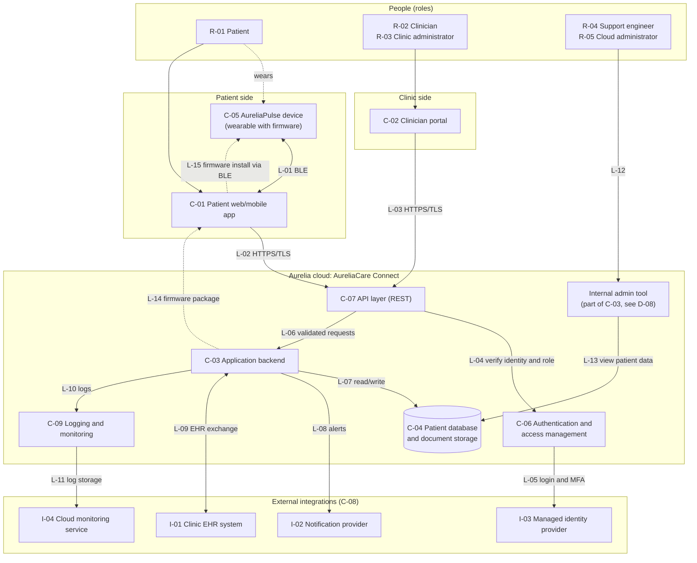

# Diagram 01. System Architecture

**Project:** Cybersecurity Risk & Product Security Assessment of a Connected Healthcare Platform\
**Author:** Kushagra Singh\
**Document version:** 0.1 (draft)\
**Date created:** 5 November 2026\
**Status:** FICTIONAL SIMULATION. The architecture is invented.\
**Activity status:** Simulated (invented design) and Documented (drawn from `docs/02-organisation-and-system-overview.md`).\

---

## 1. Purpose

This diagram shows the components of the fictional AureliaCare Connect platform and the
connections between them. It uses the IDs defined in document 02 (C-xx components, I-xx
integrations, R-xx roles). Connections are numbered L-01 onwards so later documents can reference them.

## 2. Architecture diagram

**How to read it:**
- Solid arrows are normal operating connections. Dotted arrows are the optional or occasional path (the patient wearing the device, and firmware updates).
- Double-headed arrows mean data flows both ways.
- Boxes with rounded cylinders (C-04) are data stores.

## 3. Connection (link) register

| Link | From → To | Protocol / method | What travels | Related design note |
|------|-----------|-------------------|--------------|---------------------|
| L-01 | C-05 ↔ C-01 | Bluetooth Low Energy | Health readings, pairing information | D-03 (device credential) |
| L-02 | C-01 → C-07 | HTTPS (TLS) | Login requests, readings upload, patient data views | D-01, D-06 |
| L-03 | C-02 → C-07 | HTTPS (TLS) | Clinician login, patient data requests, notes, thresholds | D-01, D-06 |
| L-04 | C-07 → C-06 | Internal call | Credentials, session tokens, role checks | D-02 |
| L-05 | C-06 → I-03 | Federated login (standard protocol) | Clinician identity and MFA results | D-01 |
| L-06 | C-07 → C-03 | Internal call | Validated requests | D-02 |
| L-07 | C-03 → C-04 | Database connection | Patient records, readings, notes | D-06 |
| L-08 | C-03 → I-02 | HTTPS API | Alert and reminder messages | None |
| L-09 | C-03 ↔ I-01 | HTTPS API, standard health-data format | Patient information exchanged with the clinic's EHR | D-05 (shared API key) |
| L-10 | C-03 → C-09 | Internal logging | Application and security events | D-07 |
| L-11 | C-09 → I-04 | Cloud-provider service | Stored logs, operational alerts | D-07 |
| L-12 | R-04/R-05 → Admin tool | Internal access | Support and administration actions | D-08 |
| L-13 | Admin tool → C-04 | Database access | Direct viewing of patient data | D-08 |
| L-14 | C-03 → C-01 | HTTPS (TLS) | Firmware update package | D-04 |
| L-15 | C-01 → C-05 | Bluetooth Low Energy | Firmware transferred to the device | D-04 |

## 4. Component coverage check

| Component | Appears in diagram? |
|-----------|---------------------|
| C-01 to C-07 | Yes, as boxes |
| C-08 | Yes, as the group containing I-01 to I-04 |
| C-09 | Yes |
| Internal admin tool | Yes, shown as part of C-03 (from design note D-08) |

## 5. What this diagram does not show

- Trust boundaries (see the data-flow diagram, next document).
- Network segments, firewalls, or cloud account structure (the design is deliberately generic).
- Internal microservices inside the backend.
- Physical security or non-technical processes.
- Any real vendor or product.

## 6. Assumptions and limitations

1. This is a simplified view. A real platform would have many more components.
2. The connection list is the author's design choice, not observed from a real system.
3. The admin tool is represented as part of C-03 to keep the ID list unchanged from document 02.