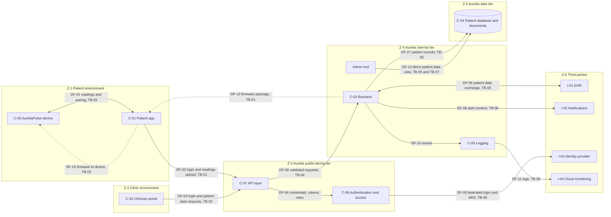

# Diagram 02. Data-Flow Diagram and Trust Boundaries

**Project:** Cybersecurity Risk & Product Security Assessment of a Connected Healthcare Platform
**Author:** Kushagra Singh
**Document version:** 0.1 (draft)
**Date created:** 5 November 2026
**Status:** FICTIONAL SIMULATION. The design is invented.
**Activity status:** Simulated (invented design) and Documented (derived from document 02 and diagram 01).

---

## 1. Purpose

Diagram 01 showed *what connects to what*. This diagram shows *how sensitive data moves*
and *where it crosses a trust boundary*.

A **trust boundary** is a line where data passes between two zones that are trusted to
different degrees (for example, from a patient's phone on the open internet into Aurelia's
cloud). Every crossing is a place where the receiving side must **not blindly trust** what
arrives: it must check identity, check permission and validate the data. Most threats in
the threat model are found at these crossings.

## 2. Trust zones

| Zone | Name | What is inside | Trust level (assumed) |
|------|------|----------------|-----------------------|
| Z-1 | Patient environment | AureliaPulse (C-05), patient phone and app (C-01), patient | Low. Devices are owned and controlled by patients |
| Z-2 | Clinic environment | Clinician browser and clinic network (the user side of C-02) | Low to medium. Controlled by customer clinics, not Aurelia |
| Z-3 | Aurelia public-facing tier | API layer (C-07), authentication (C-06) | Medium. Aurelia controls it, but it is exposed to the internet |
| Z-4 | Aurelia internal application tier | Backend (C-03), logging (C-09), internal admin tool | Higher. Internal only |
| Z-5 | Aurelia data tier | Patient database and document storage (C-04) | Highest. Holds the most sensitive data |
| Z-6 | Third-party services | I-01 EHR, I-02 notifications, I-03 identity provider, I-04 cloud monitoring | Not under Aurelia's control. Trust must be limited and verified |

## 3. Trust boundaries

| ID | Boundary | Between | Why it matters |
|----|----------|---------|----------------|
| TB-01 | Internet boundary (patients) | Z-1 to Z-3 | Anyone on the internet can try to reach this entry point |
| TB-02 | Internet boundary (clinics) | Z-2 to Z-3 | Same, with higher-value accounts (clinicians see many patients) |
| TB-03 | Short-range wireless boundary | C-05 device to C-01 phone | Bluetooth Low Energy is reachable by anyone physically nearby |
| TB-04 | Public tier to internal tier | Z-3 to Z-4 | A flaw in the API must not give free access to internal services |
| TB-05 | Application tier to data tier | Z-4 to Z-5 | Protects the most sensitive stores |
| TB-06 | Aurelia to third parties | Z-3 / Z-4 to Z-6 | Data leaves Aurelia's control; third-party failures become Aurelia's problem |
| TB-07 | Staff access boundary | Aurelia staff (R-04, R-05) to Z-4 / Z-5 | Insiders and stolen staff accounts bypass the public tier (design note D-08) |

## 4. Data-flow diagram

**How to read it:** each box group is a trust zone. Any arrow that leaves a group is
crossing a boundary, and its label names the boundary. Dotted arrows are occasional
flows (firmware updates).

## 5. Data-flow register

| Flow | From → To | Data carried | Sensitivity | Boundary crossed | Link in diagram 01 |
|------|-----------|--------------|-------------|------------------|--------------------|
| DF-01 | C-05 ↔ C-01 | Heart rate, blood oxygen, activity, pairing data | High | TB-03 | L-01 |
| DF-02 | C-01 → C-07 | Login data, readings, patient data views | High | TB-01 | L-02 |
| DF-03 | C-02 → C-07 | Clinician login, patient data requests, notes, thresholds | High | TB-02 | L-03 |
| DF-04 | C-07 → C-06 | Credentials, session tokens, role checks | High | None (same zone) | L-04 |
| DF-05 | C-06 → I-03 | Identity and MFA results | High | TB-06 | L-05 |
| DF-06 | C-07 → C-03 | Validated requests | High | TB-04 | L-06 |
| DF-07 | C-03 → C-04 | Patient records, readings, notes | Very high | TB-05 | L-07 |
| DF-08 | C-03 → I-02 | Alert and reminder text (should minimise health detail) | Medium | TB-06 | L-08 |
| DF-09 | C-03 ↔ I-01 | Patient information in a standard health-data format | Very high | TB-06 | L-09 |
| DF-10 | C-03 → C-09 | Application and security events | Medium | None | L-10 |
| DF-11 | C-09 → I-04 | Stored logs | Medium | TB-06 | L-11 |
| DF-12 | Admin tool → C-04 | Direct patient data viewing | Very high | TB-05, TB-07 | L-12, L-13 |
| DF-13 | C-03 → C-01 | Firmware package | High (integrity) | TB-01 | L-14 |
| DF-14 | C-01 → C-05 | Firmware transfer | High (integrity) | TB-03 | L-15 |

The sensitivity scale is defined in `docs/03-asset-and-data-inventory.md`.

## 6. Observations (used by the threat model)

1. Every patient and clinician request crosses **TB-01 or TB-02** and then **TB-04**. The API layer is the main gatekeeper.
2. **DF-12** crosses two boundaries and skips the application tier. Access control and logging must be enforced somewhere other than the API.
3. **TB-06** is crossed repeatedly. Aurelia cannot control what third parties do with the data it sends.
4. **DF-13 and DF-14** carry code, not just data. An attack on them affects the device itself.
5. **TB-03** is physical-proximity based. Bluetooth security depends on pairing and encryption design.

## 7. Assumptions and limitations

1. Zones and trust levels are the author's simplified, qualitative judgements.
2. Real cloud deployments have more boundaries (accounts, networks, services). They are collapsed here.
3. No real network, protocol capture or system was analysed.
